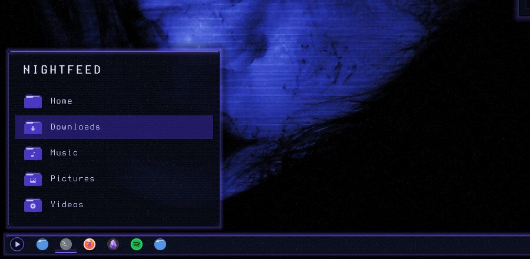
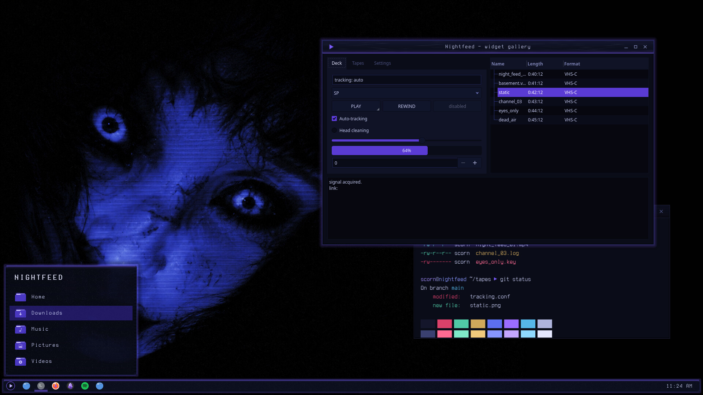

# Nightfeed — Plasma Style

Cobalt-black glass for the Plasma panel, popups and tooltips: tiled VHS scanlines and grain, a violet glow seam and violet-tinted shadows.



Nightfeed is a night-vision VHS look for KDE Plasma 6, built around a cobalt-lit face on near-black: cobalt-black surfaces, faint scanlines and tape grain, and a slight violet glow on whatever has focus.

## Features

- Panel, popups/dialogs, tooltips and widget backgrounds in cobalt-black glass.
- VHS scanlines and tape grain tiled at 1:1, so they never smear or stretch at any panel size.
- A thin violet seam along the top edge with a soft glow below it, and shadows with a faint violet bleed nearest the frame.
- Translucent variants with blur and contrast behind them, plus solid variants for when compositing is off.
- Everything else (buttons, sliders, task highlights) falls back to Breeze and follows your colour scheme, so the Nightfeed colour scheme is recommended.



## Requirements

Plasma 6.

## Install

```bash
git clone https://github.com/numbpill3d/nightfeed-plasma
cd nightfeed-plasma && ./install.sh
```

Or from the KDE Store: System Settings → Colors & Themes → Plasma Style → Install from File, or extract to `~/.local/share/plasma/desktoptheme/`.

## The rest of the suite

| piece | repo |
|---|---|
| SDDM login | [nightfeed-sddm](https://github.com/numbpill3d/nightfeed-sddm) |
| Plymouth boot splash | [nightfeed-plymouth](https://github.com/numbpill3d/nightfeed-plymouth) |
| Global theme + splash screen | [nightfeed-global](https://github.com/numbpill3d/nightfeed-global) |
| Aurorae window decoration | [nightfeed-aurorae](https://github.com/numbpill3d/nightfeed-aurorae) |
| Colour scheme | [nightfeed-colors](https://github.com/numbpill3d/nightfeed-colors) |
| Kvantum widget style | [nightfeed-kvantum](https://github.com/numbpill3d/nightfeed-kvantum) |
| Icon theme | [nightfeed-icons](https://github.com/numbpill3d/nightfeed-icons) |
| Konsole + kitty colours | [nightfeed-konsole](https://github.com/numbpill3d/nightfeed-konsole) |

Everything at once, with the generators: [nightfeed](https://github.com/numbpill3d/nightfeed).

## Tags

`nightfeed` `kde` `plasma6` `dark` `vhs` `scanlines` `cobalt` `violet` `purple` `retro` `analog-horror` `glow` `plasma-style` `desktoptheme` `panel` `plasma-theme` `translucent` `blur`

## Credits and licence

By splicer scorn (voidrane). GPL-3.0-or-later.
